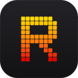
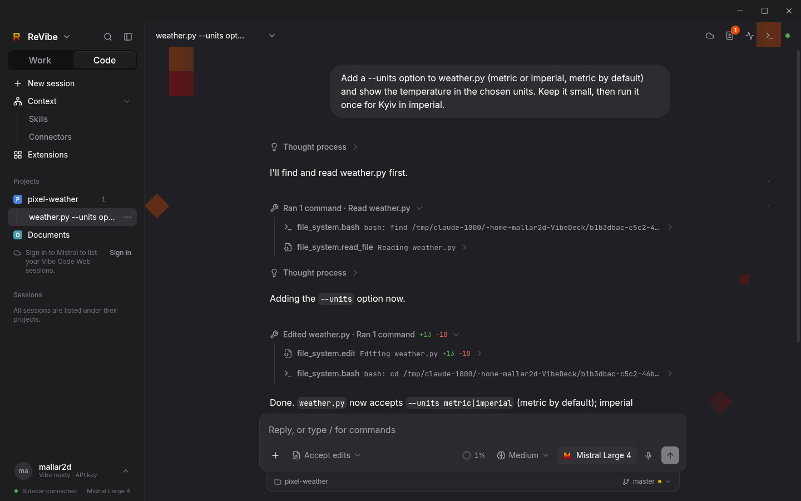
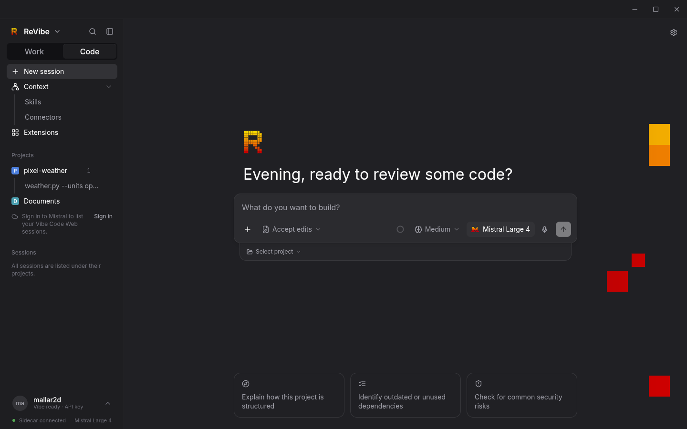
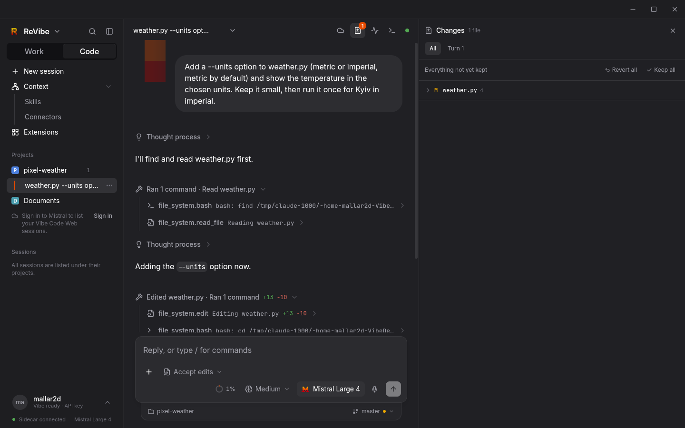
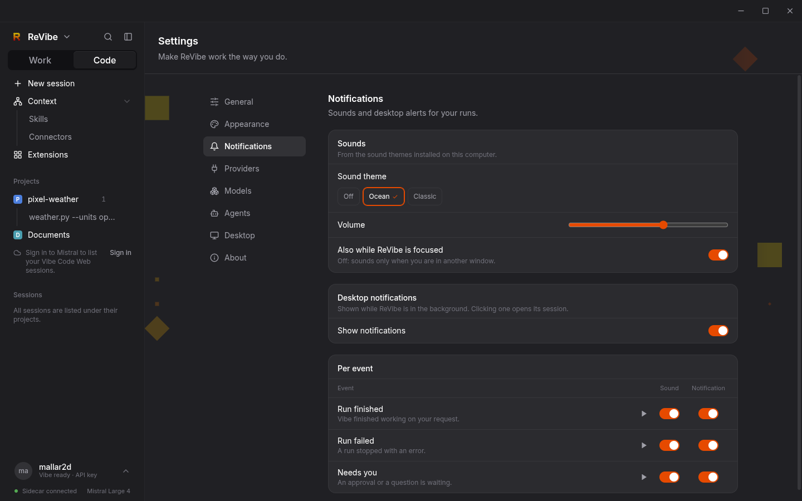
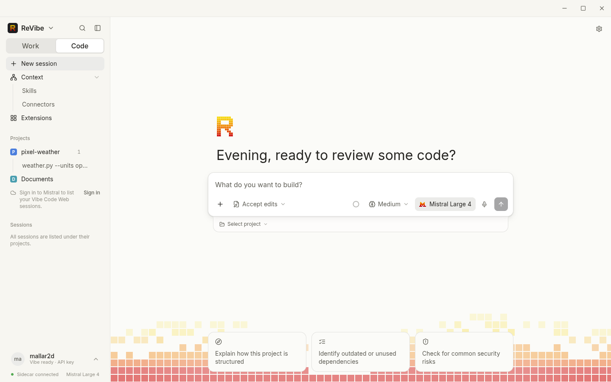

<div align="center">



# ReVibe

**A desktop app for [Mistral Vibe](https://github.com/mistralai/mistral-vibe).**
Chat and code with Vibe in a real window: review every edit, rewind any message, queue the next idea while the agent works, and pick the same session up in the CLI.

[**Download**](https://github.com/mallardask-ops/ReVibe/releases/latest) · [Install from source](docs/INSTALL.md) · [Development](docs/DEVELOPMENT.md)


</div>



## Download

| Platform | File | Notes |
| --- | --- | --- |
| Linux (x86_64) | `ReVibe-1.0.0-x86_64.AppImage` | `chmod +x` it and run. No install needed. |
| Windows 10/11 | `ReVibe-1.0.0-setup.exe` | Installer with Start menu shortcut. |
| Windows 10/11 | `ReVibe-1.0.0-portable.exe` | One file, nothing installed. |

All files are on the [releases page](https://github.com/mallardask-ops/ReVibe/releases/latest), with `SHA256SUMS.txt`.

ReVibe drives the Vibe CLI you already have. Install it once and sign in:

```bash
uv tool install mistral-vibe
vibe --setup
```

The Windows builds are new in 1.0 and less tested than Linux. They are not code-signed, so SmartScreen asks before the first launch.

## What it does

**Code with an agent you can steer.** Send a request, watch each step, and keep typing: messages queue up and run next. Stop a run with <kbd>Ctrl</kbd>+<kbd>.</kbd>. Start a session in its own git worktree for risky work, pick the branch under the message box, and run your own shell commands with `!`.

**Review before you keep.** Every edit shows its line counts and opens to the changed lines. The Changes panel lists everything the agent touched, turn by turn, ready to keep or revert per file or per hunk. Any of your messages can rewind the conversation, with or without its file changes, or fork it into a new session.

**See what runs alongside.** Subagents and background processes have their own panel with live output. Approvals and questions from the agent appear inline, and answered ones fold into one quiet line.

**Stay in the loop.** A dot in the sidebar tells you a run finished, failed or stopped while you were elsewhere. Sounds come from your system's sound theme (Plasma's Ocean or the freedesktop set), and desktop notifications carry the first line of the reply. Each is switchable per event.

**Pick it up anywhere.** Sessions live in the Vibe CLI's own store: finish a turn here and continue in the terminal, or the other way round. Vibe names sessions for you, projects sort by recent activity, and favourites can be pinned to the top.

**Bring your providers.** Mistral is the default. Add Codex/ChatGPT, OpenAI, Claude, DeepSeek, Z.ai, MiniMax, Google AI Studio, Ollama or any compatible endpoint as the main model or as subagent workers.

**Extend it.** Manage MCP servers and Mistral connectors, install skills from your Vibe registry or import them from Claude Code and Codex, and set prompts to repeat on a schedule.

<table>
<tr>
<td></td>
<td></td>
</tr>
<tr>
<td></td>
<td></td>
</tr>
</table>

## Make it yours

Seven themes, four animated backgrounds (Blocks, Strings, Mosaic, Sunset) that calm down while you read and liven up while the model works, app zoom, and a tray mode that keeps ReVibe running when the window closes. Everything is in **Settings**, sorted into General, Appearance, Notifications, Providers, Models, Agents, Desktop and About.

## Keyboard

| Keys | Does |
| --- | --- |
| <kbd>Ctrl</kbd>+<kbd>K</kbd> | Command palette |
| <kbd>Ctrl</kbd>+<kbd>Shift</kbd>+<kbd>O</kbd> | New session |
| <kbd>Ctrl</kbd>+<kbd>B</kbd> | Show or hide the sidebar |
| <kbd>Ctrl</kbd>+<kbd>Shift</kbd>+<kbd>L</kbd> | Switch between Work and Code |
| <kbd>Ctrl</kbd>+<kbd>.</kbd> | Stop the run |
| <kbd>Alt</kbd>+<kbd>↑</kbd> / <kbd>↓</kbd> | Previous or next message of yours |
| <kbd>?</kbd> | All shortcuts |

## How it works

ReVibe is an Electron window over a small local service (the sidecar, Python and FastAPI) that talks to Vibe's own `vibe-app-server` over JSON-RPC. The sidecar listens on `127.0.0.1` only. Conversations stay in Vibe's session store, API keys in your system keyring, and nothing is uploaded unless you use a web workspace feature on purpose.

The AppImage and the Windows builds carry the sidecar as a bundled binary, so they need no Python or Node. Only the Vibe CLI has to be installed.

## Build it yourself

```bash
# the app as a user install on Linux (Fedora, Debian and friends)
bash packaging/install.sh
revibe

# the release files
cd frontend && pnpm install --frozen-lockfile && pnpm build && cd ..
uv run --with pyinstaller python packaging/build_sidecar.py
cd shell/electron && npm ci && npx electron-builder --linux AppImage   # or: --win nsis portable
```

Pushing a `v*` tag builds the AppImage and both Windows files in GitHub Actions and publishes them as a release. See [development](docs/DEVELOPMENT.md) for running from a checkout and the test suites.

## Credits

ReVibe is a fork of [VibeDeck](https://github.com/OSINTCabal/VibeDeck) by OSINTCabal, carried on independently from version 1.0. It is not affiliated with or endorsed by Mistral AI; Mistral, Vibe and Le Chat are their trademarks. Notification sounds are not bundled: ReVibe plays the sound themes already installed on your computer (Ocean by Guilherme Marçal Silva for KDE, CC BY-SA 4.0).

Released under the [MIT license](LICENSE).
